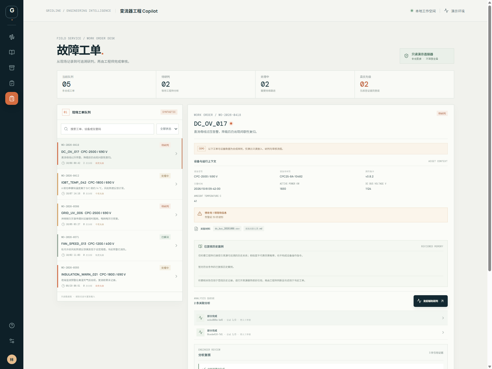
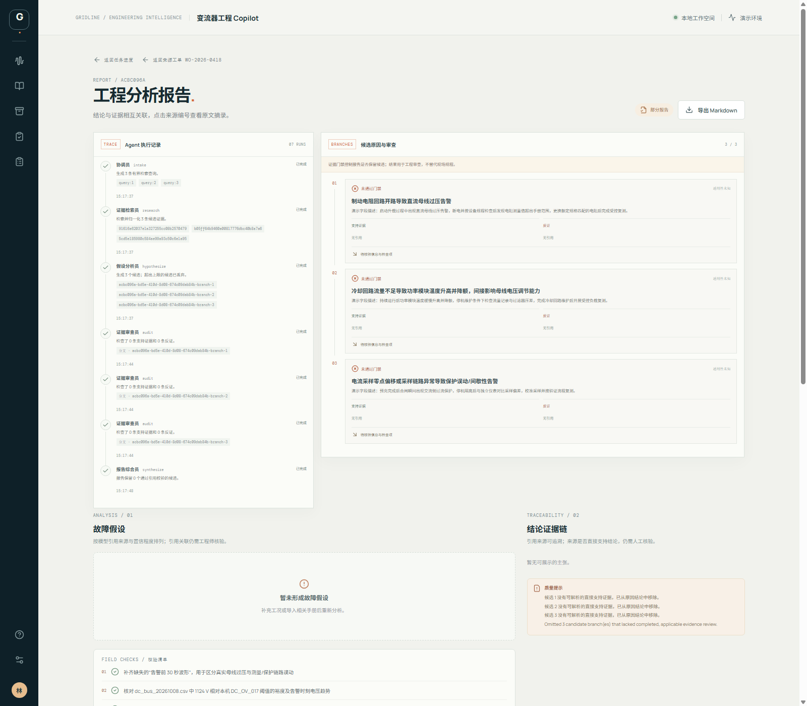

# Converter Engineering Copilot

面向变流器研发与运维场景的证据驱动工程分析工作台。系统将设备工况、企业本地技术资料、检修案例和可选网页来源组织到可追踪的分析任务中，辅助工程师开展故障现象分析、技术调研、实验设计和相似案例检索。

项目在 LangChain `open_deep_research` 的研究工作流基础上构建变流器工程应用层，包含领域数据模型、资料导入与检索、持久化任务服务、Web 工作台、人工评测和工单辅助研判。服务端使用 Python、FastAPI、LangGraph 和 SQLite；文档向量保存在本地 Chroma，中文向量默认由 FastEmbed 的 `BAAI/bge-small-zh-v1.5` 生成。前端使用 React、TypeScript 和 Vite。

## 功能

- **故障现象分析**：检查工况信息完整性，检索本地资料和可选网页来源，形成带引用的候选假设与核验步骤。
- **技术调研与实验设计**：整理技术路线、实验条件、约束、局限和可复现实验步骤。
- **检修案例检索**：导入 PDF、Markdown 或 CSV，按设备与现象检索案例，并展示匹配字段、差异和来源。
- **任务工作台**：创建分析任务、查看实时进度、定位引用摘录、回看历史任务并导出 Markdown 报告。
- **工单辅助研判**：检查工单上下文与缺失字段，关联故障分析报告，并追加带版本的人工审核记录。
- **人工评测与策略对比**：导入评测快照、复核证据支持度与检索金标准，并对比 baseline 和 collaborative 策略。
- **协作过程审计**：查看 Agent 执行阶段、候选假设、证据支持与反对信息、预算和审核状态。
- **复核记忆检索**：从符合条件且经工程师接受的历史报告中检索相关信息，并展示设备差异和证据来源。

## 界面预览

以下页面来自本机演示环境。工单与案例均为合成样例；报告展示了证据门禁在缺少可核验直接引用时拒绝保留故障候选的行为，不代表真实现场诊断结论。

### 工单队列与设备上下文

### 多 Agent 执行轨迹与证据门禁

## 工程设计

### 持久化任务与断线恢复

任务创建时，API 先将请求、幂等键和首条事件写入 SQLite，再返回任务编号。后台 worker 从数据库领取任务，通过续租和执行次数限制管理运行状态。浏览器使用 SSE 接收进度，并可用 `Last-Event-ID` 从断点继续读取。服务重启后，已排队任务会继续执行，过期租约下的任务会重新排队；因此任务采用至少一次执行语义，外部模型调用在进程中断时可能重复。

### 可追溯的证据链

报告引用关联到检索得到的来源摘录和定位信息。确定性校验器检查引用 ID 是否存在、来源状态是否冲突，避免报告引用无关来源；这项校验不代表系统独立证明了工程结论。缺少关键工况或有效证据时，工作流会请求补充信息或返回部分报告，不生成无证据支持的候选结论。

### 可恢复的本地资料导入

导入器支持 PDF、Markdown 和 CSV。系统先校验文件，再为原文和片段生成稳定标识，并在 SQLite 导入台账中记录解析版本、切块版本和预期索引数量。SQLite 与 Chroma 不能共享事务，服务会在启动时重放未完成导入；相同内容和版本可幂等重放，避免重复生成案例和向量。Web 来源台账可查看导入状态并发起修复。

### 人工复核与质量评测

评测快照保存报告声明、证据内容和来源定位，复核标签以追加版本方式记录。只有明确完成人工复核的样本进入证据支持度和检索质量指标；没有合格标签时指标保持空值。策略比较使用相同样本分别运行 baseline 与 collaborative，并将结构完整性指标与人工质量指标分开呈现。

### 多 Agent 故障分析

协作策略将故障分析拆为工况整理、证据检索、候选假设、独立证据审查、适用性检查和报告整理等受预算限制的步骤。系统持久化阶段状态、耗时、引用和结构化审查结果，供用户审阅；不展示私有思维链。历史检修相似度作为检索线索，并附带适用差异，不解释为故障因果概率。

## 系统工作流

~~~mermaid
flowchart LR
    U[工程师] --> UI[React Web 工作台]
    UI -->|REST 创建任务 / 查询报告| API[FastAPI]
    UI <-->|SSE 进度事件| API
    API -->|事务写入任务、事件与导入台账| DB[(SQLite)]
    DB --> W[持久化任务 Worker]
    W --> G[LangGraph 工程工作流]
    G --> R[本地与可选网页检索]
    R --> C[(Chroma 向量索引)]
    C --> E[FastEmbed 本地中文向量]
    G --> L[DeepSeek 模型服务]
    G -->|引用校验后的报告| DB
    UI -->|人工复核与标签| DB
~~~

主要分析流程：

1. 用户在 Web 中提交任务，API 校验输入并持久化任务。
2. Worker 按租约领取任务，LangGraph 工作流执行工况检查、检索和分析。
3. 工作流生成带来源 ID 的结构化结果，引用校验器检查来源是否可追溯。
4. API 持久化报告与终态事件；浏览器通过 SSE 更新进度并读取报告及来源摘录。
5. 工程师可对证据和结论进行复核，复核记录用于评测和后续记忆检索。

## 技术栈

| 模块 | 技术 |
| --- | --- |
| API 服务 | Python 3.11、FastAPI、Uvicorn |
| 工作流 | LangGraph、LangChain |
| 模型 | DeepSeek（可配置 API 地址和模型名） |
| 文档检索 | Chroma、FastEmbed、`BAAI/bge-small-zh-v1.5` |
| 任务与业务数据 | SQLite、版本化迁移、后台 Worker |
| Web | React、TypeScript、Vite、Nginx |
| 本地部署 | Docker Compose |

## 快速开始

### 环境要求

- Python 3.11 和 [uv](https://docs.astral.sh/uv/)
- Node.js 20+ 和 npm
- 分析任务需要可用的 DeepSeek API Key
- 首次导入或检索时会下载 FastEmbed 模型（约 100 MB）

### 本地开发

在仓库根目录创建配置文件，并在其中设置 `DEEPSEEK_API_KEY`：

~~~powershell
Copy-Item .env.example .env
uv sync --frozen
uv run uvicorn converter_copilot.api.main:app --reload --port 8000
~~~

另开一个终端启动 Web：

~~~powershell
cd web
npm ci
npm run dev
~~~

访问 <http://localhost:5173> 打开工作台，访问 <http://localhost:8000/docs> 查看 API 文档。`/api/health` 检查进程存活，`/api/ready` 检查 SQLite 写入能力和后台 Worker 状态。

本地数据默认保存在 `.data/`，包括 SQLite 数据库、Chroma 索引、FastEmbed 模型缓存、导入原文和评测结果。首次下载模型和调用模型服务需要网络连接。

### Docker Compose

在 `.env` 中配置 `DEEPSEEK_API_KEY` 后启动：

~~~powershell
docker compose up --build
~~~

Web 工作台和 API 文档分别位于 <http://localhost:5173> 与 <http://localhost:8000/docs>。Compose 中的 Nginx 容器提供构建后的静态前端并代理 API 请求，`converter_data` 命名卷保存本地数据；停止服务但保留数据可运行 `docker compose down`。

## 配置

可在 `.env` 中修改以下设置，完整模板见 [`.env.example`](.env.example)：

| 变量 | 默认值 | 说明 |
| --- | --- | --- |
| `DEEPSEEK_API_KEY` | 空 | 调用模型执行分析任务所需的 API Key |
| `DEEPSEEK_BASE_URL` | `https://api.deepseek.com` | 模型服务地址 |
| `CONVERTER_MODEL` | `deepseek-flash` | 分析任务使用的模型 |
| `TAVILY_API_KEY` | 空 | 可选网页检索凭据；留空时仍可使用本地资料 |
| `LANGSMITH_TRACING` | `false` | 是否启用 LangSmith 链路追踪 |
| `CONVERTER_DB_PATH` | `.data/converter_copilot.db` | SQLite 数据库路径 |
| `CHROMA_PERSIST_DIR` | `.data/chroma` | Chroma 索引目录 |
| `FASTEMBED_MODEL` | `BAAI/bge-small-zh-v1.5` | 本地向量模型 |
| `CONVERTER_WORKER_CONCURRENCY` | `1` | 后台任务并发数 |
| `CONVERTER_TASK_MAX_ATTEMPTS` | `3` | 单个任务最大执行次数 |

LangSmith 追踪可能包含提示词和模型输入，应只连接经批准的数据环境。更多 worker、任务租约和导入限制参数见 [本地运维指南](docs/operations.md)。

## 运行示例与评测

完整演示流程见[演示场景](docs/demo-scenario.md)，包含合成检修案例导入、相似案例检索、故障分析、引用检查和工单辅助研判。

运行确定性产品测试：

~~~powershell
uv run pytest tests/converter_copilot -q
~~~

运行模型工作流评测需要配置 `DEEPSEEK_API_KEY`：

~~~powershell
uv run python evals/converter_copilot/run_eval.py
uv run python evals/converter_copilot/run_eval.py --mode fault_analysis --compare-strategies --recall-at-k 5
~~~

仓库内案例为合成演示数据。初始样例没有检索金标准和人工支持标签，因此不能据此报告现场准确率或维修效果；人工质量指标在尚无复核样本时保持空值。评测输出和复核流程见[评测说明](evals/converter_copilot/README.md)。

## 项目文档

- [演示场景](docs/demo-scenario.md)：按 Web 工作流逐步体验任务、报告和人工复核。
- [系统架构](docs/architecture.md)：模块职责、请求生命周期、数据路径与失败处理。
- [本地运维指南](docs/operations.md)：数据库备份恢复、导入修复、配置和 CI 检查。
- [评测说明](evals/converter_copilot/README.md)：指标定义、人工标签和策略比较方法。

## 数据与使用范围

应用为研发与维护人员提供可追溯的分析材料，不连接或控制变流器，也不会自动下发设备指令。案例检索和模型报告用于辅助复核；工程结论应结合授权技术资料、实际测量和现场规程确认。项目保留上游 [open_deep_research](https://github.com/langchain-ai/open_deep_research) 的 MIT 许可声明，详见 [LICENSE](LICENSE)。
