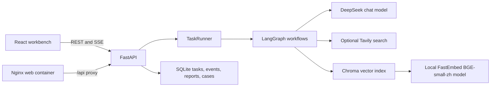

# System architecture

## Components

The repository retains the upstream `open_deep_research` graph. The added `converter_copilot` package separates typed domain schemas and evidence checks, retrieval and ingestion, graph nodes, API lifecycle, SQLite persistence, runtime configuration, and evaluation.

## Request lifecycle

1. The browser submits one of three typed task modes to `POST /api/tasks` with an `Idempotency-Key` for that action.
2. FastAPI validates mode-specific inputs. SQLite commits the queued task and its first event before the API returns HTTP 202. Repeating a key with the same canonical request returns the existing task; reusing it with a changed request returns HTTP 409.
3. A lifespan-managed worker claims queued work from SQLite under a renewable lease. The configured single-instance worker limits concurrency, execution time, and attempts. It does not depend on an in-memory queue to discover accepted tasks.
4. Graph nodes perform local and optional web retrieval. Source excerpts are passed as untrusted data to structured report generation. Missing fault operating conditions return a clarification report.
5. A deterministic validator checks citation IDs and source-status links. It verifies that references resolve to supplied evidence; it does not independently prove the scientific or engineering truth of a claim.
6. SQLite stores task status, attempt history, append-only progress events, report JSON, and case metadata. The browser reconnects to SSE using `Last-Event-ID`, then fetches the report and opens cited source excerpts.

## Persistence and observability

- SQLite: `.data/converter_copilot.db` by default.
- Schema changes use ordered `PRAGMA user_version` migrations. Before upgrading a non-empty database, the API creates a consistent SQLite online backup under `.data/backups/` by default. Backup or migration failure keeps the worker stopped and readiness unavailable.
- The API lifespan initializes storage, recovers expired leases, then starts the worker. `/api/health` is a process liveness check. `/api/ready` returns HTTP 200 only when SQLite can acquire a write lock within one second (then rolls the transaction back) and the worker polling task is alive; otherwise it returns HTTP 503 with safe component states.
- Recovery is at least once. After a process exit during a model call, that call may be repeated when its lease expires. The worker fences report and failure commits by lease owner, so a stale worker cannot overwrite a newer attempt. The Web task page shows attempt counts, recovery events, and safe error guidance.
- Run one API process against a local data directory. SQLite and Chroma do not support this app's shared single-instance worker contract across multiple API replicas.
- Chroma: `.data/chroma` by default, using the local FastEmbed BGE-small-zh model unless an embedding function is injected for tests. The DeepSeek-backed collection has a versioned name so existing OpenAI vectors remain untouched; re-import source documents to populate it.
- Evaluation output: `.data/evaluation_results/` by default.
- Worker defaults: concurrency `1`, poll interval `0.5` seconds, lease `60` seconds, timeout `1800` seconds, and maximum attempts `3`. Override them with the `CONVERTER_WORKER_*` and `CONVERTER_TASK_*` environment variables; invalid non-positive values prevent readiness.
- Optional LangSmith tracing is enabled only when `LANGSMITH_TRACING=true` and `LANGSMITH_API_KEY` is present. Each run is tagged with task ID and mode. Traces can include prompts and model inputs, so enable them only for data approved for that workspace.

## Local and container networking

For local development, Vite proxies `/api` to `http://localhost:8000`. In Compose, Nginx serves the production bundle and proxies `/api/` to the API container; SQLite and Chroma share one named volume. Only the API service receives provider secrets. The browser bundle has no provider key.

## Failure and safety boundaries

- Missing API configuration prevents task dependency construction; the UI and API process can still start for health checks.
- Empty retrieval produces a partial report instead of fabricated hypotheses or comparisons.
- Provider/workflow exceptions mark the task failed with a safe category such as `workflow_error` or `task_timeout`; application logs, API responses, and task events do not include raw exception text or worker IDs.
- A citation marked `supported` means the report's evidence ID resolves and its source is not marked conflicting. It is not an independent fact check.
- Case similarity is a retrieval hint, not a causal conclusion. Synthetic demo rows are clearly identified in the source dataset and must not be represented as field history.
- The app does not connect to equipment or issue control commands. A qualified engineer must verify findings against source manuals, measurements, and site procedures.
