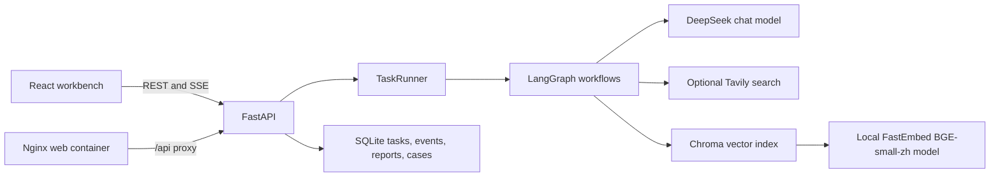

# System architecture

## Components

The repository retains the upstream `open_deep_research` graph. The added `converter_copilot` package separates typed domain schemas and evidence checks, retrieval and ingestion, graph nodes, API lifecycle, SQLite persistence, runtime configuration, and evaluation.

## Request lifecycle

1. The browser submits one of three typed task modes to `POST /api/tasks`.
2. FastAPI validates mode-specific inputs. `TaskRunner` compiles the selected graph, persists the queued task, and starts one background invocation.
3. Graph nodes perform local and optional web retrieval. Source excerpts are passed as untrusted data to structured report generation. Missing fault operating conditions return a clarification report.
4. A deterministic validator checks citation IDs and source-status links. It verifies that references resolve to supplied evidence; it does not independently prove the scientific or engineering truth of a claim.
5. SQLite stores task status, append-only progress events, report JSON, and case metadata. The browser reconnects to SSE using `Last-Event-ID`, then fetches the report and opens cited source excerpts.

## Persistence and observability

- SQLite: `.data/converter_copilot.db` by default.
- Chroma: `.data/chroma` by default, using the local FastEmbed BGE-small-zh model unless an embedding function is injected for tests. The DeepSeek-backed collection has a versioned name so existing OpenAI vectors remain untouched; re-import source documents to populate it.
- Evaluation output: `.data/evaluation_results/` by default.
- Health: `/api/health` confirms the process responds. Readiness: `/api/ready` performs a SQLite read and returns HTTP 503 if storage is unavailable.
- Optional LangSmith tracing is enabled only when `LANGSMITH_TRACING=true` and `LANGSMITH_API_KEY` is present. Each run is tagged with task ID and mode. Traces can include prompts and model inputs, so enable them only for data approved for that workspace.

## Local and container networking

For local development, Vite proxies `/api` to `http://localhost:8000`. In Compose, Nginx serves the production bundle and proxies `/api/` to the API container; SQLite and Chroma share one named volume. Only the API service receives provider secrets. The browser bundle has no provider key.

## Failure and safety boundaries

- Missing API configuration prevents task dependency construction; the UI and API process can still start for health checks.
- Empty retrieval produces a partial report instead of fabricated hypotheses or comparisons.
- Provider/workflow exceptions mark the task failed; persisted events expose the exception type but not the raw exception payload.
- A citation marked `supported` means the report's evidence ID resolves and its source is not marked conflicting. It is not an independent fact check.
- Case similarity is a retrieval hint, not a causal conclusion. Synthetic demo rows are clearly identified in the source dataset and must not be represented as field history.
- The app does not connect to equipment or issue control commands. A qualified engineer must verify findings against source manuals, measurements, and site procedures.
