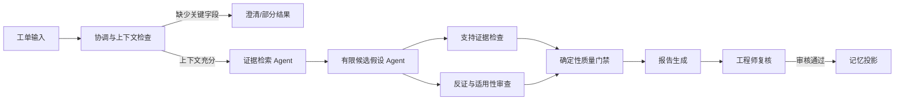

# 变流器工程 Copilot 多 Agent 协作与可审计记忆设计

- 日期：2026-10-10
- 状态：待用户审阅
- 目标版本：V1.3（暂定）
- 部署边界：本机单用户；不要求公网部署

## 1. 背景与问题

当前应用已有 LangGraph 工作流、并发本地/公开资料检索、SQLite 任务事件和报告持久化、证据引用校验、工单人工复核以及 React 任务页面。故障分析主流程仍主要是“输入校验 → 并发检索 → 单次结构化报告生成”，检索并发本身还没有形成具有明确契约的角色化 Agent 协作；UI 也未展示每个角色的贡献、候选假设如何被支持或削弱，以及审核后哪些信息成为可复用记忆。

本次升级要把多 Agent 落成可限制、可观测、可评测的工程工作流。面向现场工程人员的最终输出仍是带证据、限制和人工审核入口的辅助分析，不构成设备控制指令或安全操作规程。

## 2. 目标

1. 将故障分析主流程扩展为职责清晰、输入输出有类型约束的 Agent 协作图，并保留已有工作流模式和报告兼容性。
2. 以有限的候选故障假设树表达分支探索；每个候选都能追溯支持证据、反对证据、适用性、缺失信息和下一项安全核验。
3. 形成可查询的结构化记忆网络，连接设备、症状、工况、假设/故障原因、证据、工单案例和人工审核；只有经过人工确认的内容可进入长期复用记忆。
4. 通过现有任务事件/SSE 和 Web 详情页面展示 Agent 阶段、假设分支、证据关系及记忆来源；不展示模型隐藏的原始 CoT。
5. 通过离线评测比较基线工作流与协作工作流，显式报告证据支持质量、反证发现、无依据结论、完成率、延迟和可获得的模型使用量。
6. 将 Agent、记忆、候选分支和审查记录保存到本地 SQLite，支持任务页面重载后恢复查看。

## 3. 非目标与边界

- 不收集、保存或向用户显示模型隐藏的逐 token 私有思维链。可展示的只有结构化任务计划、简明依据摘要、阶段输入输出摘要和证据链接。
- 不实现无上限的 ToT 搜索、模型之间无限辩论、自我递归扩展或无界并发。候选数量、每候选审查次数、整体重试和模型调用预算均需有配置上限。
- 不允许 Agent 直接控制设备、下发参数、创建或关闭真实外部工单、替代厂商手册/现场规程或作出自主安全决策。
- 不接入厂商私有系统、实时遥测、企业认证、多租户或团队权限；继续使用已声明的本地单实例运行边界。
- 不把合成样例或未审核模型输出描述成真实现场记忆/知识；现有工单和评测数据中的 synthetic 标记继续保留。
- 第一版不引入图数据库、向量化“记忆即事实”机制或模型微调。SQLite 关系/节点/边记录提供可迁移的逻辑图视图。
- 技术调研和案例检索模式先维持当前流程；其 Agent 事件 schema 可复用，但 V1.3 的角色协作重点限定为工单故障分析。

## 4. 用户流程

1. 用户在现有工单详情发起故障分析。协调角色验证字段，识别缺失工况；必要时继续走已有澄清/部分报告路径，不在资料不足时强行展开诊断。
2. 规划器产生有上限的检索任务。证据 Agent 对本地资料、历史工单和允许的公开来源并发检索，并返回统一证据记录。
3. 假设 Agent 基于输入与已收集证据提出不超过配置上限的候选原因。每个候选提供结构化机理摘要和预期可区分它的工程观测，不得把未证实假设写成事实。
4. 反证审查角色针对各候选检查支持、冲突、设备适用性和证据缺口。若证据不足，明确保留“不确定/需补充信息”分支。
5. 确定性质量门禁验证证据 ID、来源状态、claim 链接和各候选边界；不满足条件的候选降级或从结论中移除。最终报告继续通过现有 `validate_report_evidence` 规则。
6. 用户查看报告、Agent 时间线、假设树和证据，使用已有工单复核入口给出接受、补充信息或拒绝结论。
7. 只有审核通过且满足记忆准入规则的字段可被投影到长期记忆；保留其原始 task、work order、review event 和 evidence 来源，且允许撤销/标记过期。

## 5. 架构与 Agent 契约

### 5.1 工作流

使用 LangGraph 节点/条件边实现此流程。并行审查结果写入显式 reducer/state 字段，报告聚合按稳定的假设 ID 与证据 ID 去重，避免并行状态更新相互覆盖。每个节点不直接写自由文本日志，而是产出类型化结果和有限长度的 UI 摘要。

### 5.2 Agent 角色

| 角色 | 负责 | 不负责 | 主要输出 |
|---|---|---|---|
| coordinator | 输入充分性、有限计划、预算和停止条件 | 自行编造工程事实 | `AgentPlan`、缺口列表、计划事件 |
| evidence researcher | 按计划检索资料、归一化证据和适用设备 | 给出根因结论 | 证据 ID、来源/定位、检索分支摘要 |
| hypothesis analyst | 生成有限候选及可区分的核验项 | 把候选当成确认结论 | `HypothesisBranch` |
| evidence auditor | 为指定候选识别支持/反对证据、设备差异和缺口 | 覆盖或删除原始证据 | `BranchReview` |
| report synthesizer | 只从通过门禁的结构化数据生成现有报告 schema | 增加未绑定来源的新事实 | 兼容 `ConverterReport` 与审计摘要 |

所有角色可以由相同的 DeepSeek 模型和不同的受限提示/结构化 schema 承载；Agent 指的是有独立职责、输入输出契约和运行记录的工作单元，不要求每个角色部署单独模型。

### 5.3 有限假设树（ToT）

每个 `HypothesisBranch` 至少记录：稳定 `branch_id`、父分支 ID（根节点为空）、候选表述、机理摘要、支持/反对 evidence ID、适用性、缺失字段、待确认的核验项、门禁状态和最终处置。V1 初始上限建议为最多 3 个根候选、每个候选最多 1 次反证审查、无递归子分支；最终限额在实施计划中固定为配置默认值并设置硬上限。

候选排序和门禁使用可解释、可测试的确定性规则，例如：支持证据是否存在、来源是否可用、设备是否直接匹配、是否存在明确反证、关键条件是否缺失。LLM 给出的置信文字可作为报告属性，但不能单独解除门禁或覆盖反证。树的分数不宣称为统计概率。

## 6. 可审计推理记录（CoT 替代）

新增 Agent run/event 记录，字段仅包含：`task_id`、`agent_run_id`、角色、节点阶段、状态、父 run/branch ID、开始/结束时间、输入对象/证据 ID、结构化输出引用、简明摘要、错误类别、重试计数以及提供方 usage（仅在 SDK 实际提供时记录）。不得记录 API key、完整私有隐藏思维链、完整 prompt/对话历史或未经脱敏的任意外部异常文本。

前端将上述记录表述为“执行过程/审计轨迹/结论依据”，明确简明摘要是模型生成的说明而非独立事实验证。最终结论必须仍可从 claim/hypothesis 导航到 `evidence_id` 和来源片段；无 usage 时显示“提供方未返回”，不能推算为精确 token 或费用。

## 7. 记忆网络

### 7.1 记忆类别与节点关系

- 工作记忆：仅为正在运行的任务共享 LangGraph state，随任务快照/报告持久化；不作为跨任务事实复用。
- 情景记忆：已完成且经过工单人工审核的案例事实、审核结论和发生条件。
- 语义记忆：从已审核案例投影出的受限关系，如“设备型号—在工况—出现症状—关联已验证原因—由证据支持”。每条关系带来源 task/work order/review version/evidence ID、审核状态和有效性元数据。

逻辑实体节点包括 equipment、symptom、condition、hypothesis/cause、work_order、evidence；关系只采用受控枚举，不开放模型任意创建关系类型。结构化案例表仍是事实来源；记忆网络是带出处的检索投影，不复制一个无法校验的知识真相源。

### 7.2 准入、查询与纠错

- 仅 `accepted` 的人工工单审核可触发长期记忆投影；`needs_more_information` 和 `rejected` 不能提升为已验证语义记忆。
- 字段缺失、synthetic demo、无有效 evidence 链接、引用已删除来源的关系不进入可复用结果；可以保留为不可复用的审计事件。
- 记忆查询返回命中原因、源案例、审核记录、设备/工况差异及证据链接。相似度只用于召回，不能推断因果。
- 重复实体使用规范化键和稳定 ID 去重；关系以来源审核版本幂等写入。审核被更正/撤销或来源删除时，关系应失效或标记待修复，不静默保留为有效事实。
- API 返回的记忆数据只对本地单用户工作台可见；不引入虚构 reviewer 身份认证。

## 8. 数据与持久化

SQLite 通过新增有序 schema migration 扩展，表结构至少覆盖：

- `agent_runs`：一次角色执行的状态、摘要、边界内元数据及输出对象引用；
- `hypothesis_branches`：任务内树状候选、支持/反证 ID、适用性、状态及处置；
- `memory_nodes` / `memory_edges`：受控类型实体与有出处的关系；
- `memory_sources` 或等价来源关联：审核版本、task/work order、evidence 及 synthetic 状态。

精确表名、JSON 列与索引由实施计划确定。所有新增任务记录必须引用现存 `tasks`；记忆关系具备明确外键/来源校验和幂等约束。旧报告读取兼容，不强制重跑历史任务；升级沿用项目现有迁移备份与启动阻断行为。

## 9. API 与 Web 体验

- Agent 阶段事件复用现有任务事件持久化和 SSE 重放，不新增另一条只能内存读取的状态流。
- 增加按 task 查询 Agent runs、候选分支及其 evidence links 的读取接口；增加受审核结果约束的记忆查询接口。审核写入继续使用既有 work-order review API，不重复制造互相冲突的审核模型。
- 任务页新增“协作过程”面板：按角色展示等待/运行/完成/跳过/失败、时间和结构化摘要；阶段失败用现有任务失败类别表达，不泄漏内部异常。
- 报告页新增假设树/候选比较区，显示每个候选的支持、反证、设备适用性、缺口、核验项和门禁结果，支持点击证据打开现有 `EvidenceDrawer`。
- 工单详情增加“相关已审核记忆”区，标明数据来源、审核结果、差异和合成数据标识；不把召回案例展示成自动因果判定。
- 界面避免“展示思维链”标签，使用“Agent 执行记录”“候选假设与证据”“记忆来源”等名称。

## 10. 评测与可观测性

基于现有人工评测闭环增加与本设计对应的字段/派生指标。至少区分：

1. 单 Agent/现有流程基线与协作流程的相同输入对比；
2. 候选证据引用有效率、每候选支持/反证覆盖、无依据候选率、设备适用性错误率、明确弃答/待补充率；
3. 使用人工审核标签的 precision/recall 类指标；无足够审核样本时显示 null 和样本不足原因；
4. 工作流成功/部分完成率、节点延迟、重试、人工复核处置和实际提供方 usage（若有）。

合成样例只能做流程回归和 schema 测试，结果明确标记 synthetic；不得与人工审核指标合并后宣传为真实领域准确率。每个评测结果保存工作流/提示/候选策略版本，避免比较时混入配置变化。

## 11. 安全、错误和资源边界

- 只读使用用户输入、历史工单和来源文档；检索内容是非可信数据，不能把其中的指令提升为 Agent 系统指令。
- 设置硬上限：最多假设数、并行审查数、节点重试、任务总时长及可配置模型调用预算；预算耗尽后给出部分结果和明确原因。
- 某个审查角色失败时，相关候选进入 `review_incomplete`/部分报告，不允许当作“审查通过”；其他独立分支可完成。
- 空证据、证据冲突、设备不匹配、关键工况缺失和记忆来源失效均明确显示；系统不从相似案例中补造现场值。
- 新增数据库 migration 失败应复用现有启动阻断和备份策略；SSE 断线后按 event ID 可恢复完整协作时间线。

## 12. 验收标准

1. 故障工单输入字段不足时沿用澄清/部分报告路径，不进入会生成确认性故障结论的分支。
2. 输入充分且有检索结果时，协调、检索、假设、反证审查、门禁和报告阶段均有持久事件和可读状态；多分支结果可稳定汇总。
3. 候选数、并发数、审查次数和重试数始终不超过硬上限；模型无法通过自报高置信度绕过确定性证据门禁。
4. 每个最终候选/claim 的 evidence ID 必须解析到当前任务来源；反证及跨设备/未知适用性不会被隐去；失败审查不能伪装成完成。
5. 服务重启/页面重载后可恢复已有 Agent 时间线、候选树、报告和证据链接；事件不包含密钥、隐藏 CoT 或原始异常栈。
6. 只有满足来源及人工审核准入条件的数据可出现在可复用记忆查询中；synthetic、拒绝/补充信息、缺证来源不会成为已验证知识。
7. 纠正或撤销审核后，其记忆投影按来源版本失效/更新；重复执行投影不会产生重复有效关系。
8. Web 页能直观展示 Agent 分工、候选假设支持/反证/缺口、证据跳转、相关已审核记忆及其出处。
9. 评测能在同一数据集上对比旧基线和协作工作流，并如实标注样本来源、人工标签数量、配置版本、延迟和 usage 缺失。
10. 原有技术调研、案例检索、工单复核、任务重试、证据抽屉和无模型密钥运行能力保持可用；本次不调用设备写接口或要求公网部署。

## 13. 交付分期建议

1. **可观察协作骨架**：事件契约、有限故障协作图、持久 Agent runs 和迁移。
2. **候选审查 UI**：假设树、支持/反证审查、确定性门禁和报告链接。
3. **审核记忆网络**：审核准入、来源图关系、历史记忆读取和工单 UI。
4. **质量对比**：离线对照评测、指标展示、运行边界和用户文档。

每一期均可本机独立验收；不把数据库图谱、企业连接器或在线部署作为前置依赖。
