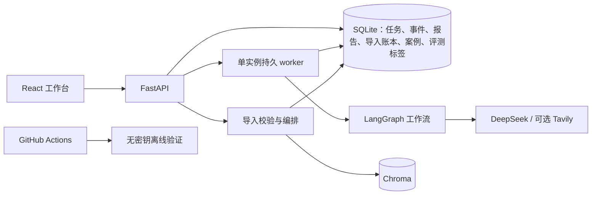

# Converter Engineering Copilot 本地可靠性 V1 设计

日期：2026-10-10
状态：待用户审阅
范围：单机、本地运行的可靠性升级；不包含公网部署。

## 1. 背景与问题

项目已经具备 DeepSeek 工作流、React 工作台、FastAPI、SQLite 任务与报告存储、Chroma 本地向量检索、案例导入和离线评测入口。但几个关键流程仍接近演示原型：

- `TaskRunner` 在写入任务后直接创建进程内 `asyncio.Task`，重启会丢失执行上下文；没有持久队列、任务租约或并发上限。
- SQLite 通过 `CREATE TABLE IF NOT EXISTS` 初始化表，没有有序的 schema migration。
- 导入接口先读取整个上传、写入 Chroma，之后才解析 CSV 并保存案例。CSV 解析错误可能留下向量；重复导入会产生新案例 ID。
- SQLite 和 Chroma 分属两个存储系统，无法共享事务。当前实现没有导入账本、失败补偿或一致性巡检。
- 评测样例的检索 gold labels 为空，证据标签为 `unverified`。这类数据不能支持召回率或人工证据支持率的质量结论。
- GitHub Actions 还没有覆盖产品后端、前端和容器构建的常规 CI；仓库根目录现有 pytest 配置还会因上游遗留的 `--research-agent` 参数导致测试入口失败。

这次升级将这些边界做成可恢复、可诊断、可在无模型密钥条件下验证的单机产品流程。

## 2. 目标

1. API 接受任务前先将其和排队事件可靠写入 SQLite；API 进程重启后，未完成任务可继续处理。
2. 任务使用持久队列和租约领取，限制并发；任务执行采用至少一次语义，重复执行不会产生重复报告或失控的重试关系。
3. SQLite schema 通过有版本、有事务、可诊断的 migration 演进，并保留现有本地数据。
4. 导入文件在写入任何持久存储前完成格式、大小和内容校验；相同文件和解析版本重复导入具有幂等结果。
5. SQLite 与 Chroma 的跨存储导入具有持久状态、补偿或修复路径，并能发现不完整记录。
6. 评测数据明确区分演示、待标注和人工审核标签；无人工 gold label 时不发布质量分数。
7. 产品 CI 能在无 DeepSeek、Tavily、LangSmith 密钥的环境里验证后端、前端、恢复/幂等流程和 Docker 镜像构建。
8. Web 前端能展示任务排队、运行、恢复、失败、导入状态和评测标签状态，方便本地用户诊断。

## 3. 非目标

- 公网部署、域名、TLS、公开身份认证、组织/租户隔离和面向公网的速率限制。
- 多机 worker、Redis、Kubernetes、云数据库或分布式锁。
- 在 CI 中调用 DeepSeek 或其他付费模型，或将人工标签自动伪造成 gold labels。
- 把合成演示数据描述为现场事故、已验证 benchmark、真实召回率或已实现的维护收益。
- 改变逆变器工作流的工程判断边界：模型输出仍是辅助信息，引用校验仍不等于事实核验，也不控制设备。

## 4. 用户与部署模型

V1 服务于一位本地使用者或一个可信本地工作区。部署由一个 API 进程内的持久任务 worker 组成，数据目录位于本机持久磁盘。SQLite 和 Chroma 目录仅由此实例写入。Docker Compose 保持单实例运行；同一数据卷不能挂载给多个写入实例，也不将数据库目录放在不保证 SQLite 锁语义的网络文件系统上。

DeepSeek、可选 Tavily、可选 LangSmith 仍按现有运行时配置使用。没有模型密钥时，API 健康检查、数据读取、文件校验、migration、确定性测试和前端仍可运行；只有需要模型的工作流拒绝启动并给出可操作错误。

## 5. 设计概览

SQLite 是任务状态、导入状态、案例元数据和评测标签的事实来源。Chroma 保存可重建、按稳定 ID 寻址的向量记录。两者不宣称具有跨存储原子性；应用通过持久导入状态和幂等补偿来收敛。

## 6. 持久任务与恢复

### 6.1 接收与排队

`POST /api/tasks` 先验证工作流模式和输入，再在一个 SQLite 事务中写入任务及 `queued` 事件。只有事务成功后才返回任务 ID 和已接受状态。worker 轮询持久队列，因此 API 返回和进程内调度之间不再有丢任务窗口。

客户端可传幂等请求键。SQLite 保存该键和规范化请求摘要：相同键、相同请求返回原任务；相同键、不同请求返回冲突。没有幂等键时每次请求创建独立任务。重试接口在单个事务内创建新任务、写入 retry 关系和排队事件，避免“新任务已创建但重试关系未写入”的中间状态。重试次数继续受限，并只允许对 `failed` 或 `partial` 任务重试。

### 6.2 领取、租约与崩溃恢复

worker 在短 SQLite 写事务中领取一个 queued 任务，将其置为 running，记录 worker/lease 标识、租约截止时间和 attempt 序号，并追加状态事件。领取操作使用 SQLite 事务保证单实例内同一时刻只有一个 worker 获得该任务。最大并发数、轮询间隔、任务超时和租约时长作为配置项；取值在实施计划中确定并记录于示例配置。

worker 定期续租。启动时和运行期间，恢复器查找租约过期的 running 任务，将其重新排队并记录 `recovered` 事件；进程退出后未过期的任务在租约到期后可恢复。任务的 attempt 递增，事件保留此前尝试的轨迹。用户取消/终止任务的行为不在 V1 范围内。

执行语义为至少一次：模型调用可能在进程崩溃前已经发生，系统无法保证模型侧只调用一次。每个任务只有一个逻辑报告槽位；报告按 task ID 幂等 upsert，状态和完成事件通过事务写入。恢复尝试在成功前不得覆盖已完成报告。完成任务不会重新入队。重复执行可能产生重复成本，但不会产生多个任务报告或重复 retry 链接。

若持续失败或超过有界 attempt 策略，任务以 `failed` 结束，写入安全错误类别和可追踪的 attempt 事件；原始密钥、完整提示词、上传正文和原始异常文本不得写入普通事件或 API 响应。服务日志可记录带 task ID 的异常类型和受控诊断信息，敏感字段需脱敏。

### 6.3 API 与前端状态

- 任务列表/详情提供排队、运行、部分完成、完成、失败状态，以及 attempt、创建/更新时间和可读错误类别。
- SSE 继续使用持久事件 ID 和 `Last-Event-ID` 重连；断线重连后客户端先补齐历史事件，再订阅新事件。
- 健康检查表示 API 进程可响应；readiness 还验证 SQLite migration 完成、存储可读写和 worker 初始化成功。迁移或存储不可用时 readiness 返回不可用原因，不暴露数据库路径和敏感配置。
- 任务错误提供安全、面向用户的下一步建议；不要把服务端栈跟踪放进浏览器。

## 7. SQLite schema migration 与兼容

以 `PRAGMA user_version` 或等价的单一 schema 版本表跟踪版本；每个 migration 有确定的起止版本、事务边界和顺序。应用启动时先获取单实例初始化锁，执行必要 migration，成功后再启动 worker 并报告 ready。migration 失败时不启动写任务 worker，记录版本、阶段和安全错误，并让 readiness 失败。

初始 migration 从当前表结构升级，不删除现有 tasks、events、reports、cases、retries 数据。为旧数据填充兼容默认值，旧任务若状态为 running，则按租约恢复规则重新排队；旧记录的内容不重写。migration 必须可在空数据库和现存数据库执行。迁移前备份策略、SQLite busy timeout 和 WAL 等运行参数在实施计划中落定；任何备份失败都必须在改变 schema 前显式失败。

新增持久数据至少覆盖：schema version、任务幂等键/请求摘要、attempt/租约状态、导入账本和稳定文档/案例来源关系、评测标签的审核状态与审计元数据。对任务完成、重试创建、导入状态推进和评测标签保存定义事务边界。SQLite 的事件表保持追加写；修正错误通过新事件表达，不原地改写事件历史。

## 8. 文件导入、去重和一致性

### 8.1 校验先于写入

导入流程先将上传内容限制在配置的字节上限内，然后验证扩展名与实际可解析内容。CSV 在索引前完成严格 UTF-8 解码、表头和必需字段校验、行数/字段上限检查以及所有行解析；坏行按整文件拒绝并返回行号和安全原因，不静默跳过。PDF 在索引前检查页面数和提取结果，Markdown 检查解码和非空内容。各格式上限可配置，初始默认值在实施计划和 `.env.example` 中公开。

所有校验成功后才建立导入账本并开始持久写入。HTTP 错误使用稳定错误码和字段，不包含上传正文。前端展示校验阶段、失败文件/行、索引中、可用、需修复等状态。

### 8.2 内容身份与幂等

计算源内容 SHA-256，并将规范化文件类型、解析器版本、分块器版本纳入导入身份。相同内容和相同处理版本重复上传返回已有导入结果，不重复写向量或案例。解析器/分块器版本改变时创建新的处理版本，保留可解释的旧导入关联；清理旧向量由显式重建/清理流程处理，不在普通导入中静默覆盖。

文档 ID、chunk ID 和由源行生成的 case ID 必须确定性地从导入身份及稳定 locator 派生，不依赖临时文件路径、随机 UUID 或输入到达顺序。案例保存来源导入 ID、源行/页码定位符和 evidence IDs，以支持去重、追溯和删除。

### 8.3 跨 SQLite/Chroma 写入与修复

导入账本至少具有 `validated`、`indexing`、`complete`、`failed`/`needs_repair` 状态、内容摘要、处理版本、预期和已写记录数、时间戳及安全错误类别。导入状态推进写 SQLite；向量以稳定 ID 幂等 upsert；案例按稳定 ID upsert。

执行顺序：完成全部校验；事务登记导入；写向量；写案例；核对预期计数/标识；最后事务标记 complete。若进程在步骤间崩溃，启动恢复器或显式重试依据账本重放缺少的稳定 ID 并继续，而非创建重复记录。若向量存储失败，则保留可诊断的非 complete 状态并允许安全重试；若数据库案例保存失败，重复向量 upsert 后重试案例写入。因为存储之间没有原子事务，不能承诺瞬时强一致性。

提供本地修复/一致性检查入口，比较 complete 导入的 SQLite 预期记录与 Chroma 记录，发现缺失向量、孤儿案例和非 complete 导入。修复优先从保留的源文件内容或导入记录重建；项目需明确源文件是否持久保存在数据目录。如果没有源文件备份，UI 必须提示重新上传原文件，不可声称可自动重建。删除导入/案例时按来源关系删除案例及对应向量，操作通过删除状态/补偿重试来处理跨库失败；删除 API 具体形态在实施计划确定。

## 9. 人工评测闭环

评测记录应显式包含数据来源类型（如 `synthetic_demo`、`curated_local`）、标签状态（`unlabeled`、`pending_review`、`reviewed`）、审核者标识、审核时间、标签版本，以及证据支持标签和检索 gold IDs。人工审核状态改变必须保留修改历史或追加审计事件。现有 starter examples 保持未标注状态，不能自动升级为 reviewed。

确定性验证分成两类：

1. 每次 CI 验证 JSONL schema、唯一 example ID、模式输入结构、标签取值、审核元数据一致性和指标实现的固定小样例。
2. 对已审核数据运行离线指标回归。空 gold labels 或没有 reviewed 支持标签时，Recall@K 或 manual evidence support rate 保持 `null` 并标记 `insufficient_labels`，不填 0、不忽略后宣称通过，也不拿合成 starter 数据做质量门槛。人工完成首批标签后才启用带版本的质量基线。

Web 评测页面显示总样本、待审核/已审核数、数据来源、可计分样本数、指标样本数、指标值或不可计算原因、基线版本和差异。每条人工标签可查看对应来源片段并保存审核信息。未经用户明确标注和审核的数据不参与质量得分。

## 10. CI 与本地验证

新增 GitHub Actions 产品流水线，至少包含：

- Python 产品包格式/静态检查（项目已有工具配置范围内）和 converter copilot 后端测试。
- SQLite migration、任务队列恢复/幂等、重试事务和 SSE 历史补齐测试。
- 文件导入成功、重复导入、畸形/超限文件拒绝、跨存储部分失败重放和一致性修复测试。
- 前端依赖安装与 production build。
- Docker 镜像构建，不启动依赖外部 key 的真实模型工作流。
- 评测数据 schema、审核状态契约和确定性指标测试。

CI 不注入 `DEEPSEEK_API_KEY`、Tavily 或 LangSmith 密钥，不下载或调用外部模型来判断测试成功。用 fake workflow、fake embedding/vector adapter 和临时 SQLite/Chroma 测试隔离外部服务。Docker build 若需下载依赖，仅构建镜像，不启动网络服务或部署。

根目录 pytest 入口需要修复上游 `--research-agent` 参数问题或明确注册该选项，使产品与 legacy 测试都可发现并得到明确结果。不得通过无说明地排除整个 legacy 测试目录来伪造全套通过。若 legacy 测试依赖不可用，流水线应单独展示其状态和原因，产品测试仍有独立明确的必过 job。

本地验证命令、必需的非密钥工具版本、启动方式、migration 回滚/备份说明、导入修复操作、测试边界和 GitHub Actions 状态说明同步写入 README/运维文档，避免仅维护者知道恢复方式。

## 11. 验收标准

1. 创建任务的 SQLite 事务提交后立即模拟 API 进程退出；重新启动后任务可被领取并最终进入完成、部分完成或失败的明确终态。
2. 在工作流运行中模拟 worker 崩溃；租约超时后任务重新排队，attempt 与 `recovered` 事件可查；已完成任务不会重复执行。
3. 对同一幂等键和请求重复提交只得到一个 task ID；同键不同输入返回冲突。重复调用 retry 不会丢失 retry 关系或超过限制。
4. 从空库和当前版本样例库运行 migration，已有任务/事件/报告/案例保留；migration 错误阻止 worker 启动并使 readiness 失败。
5. 相同文件重复导入返回相同逻辑文档和案例集合，不增加向量和案例计数；解析版本变化能被识别。
6. 畸形 CSV、缺少必需列、超过文件/行/页限制的文件在产生任何案例或向量前被拒绝；错误可定位到安全的文件/行信息。
7. 注入 SQLite 或 Chroma 写入失败后，导入显示非 complete 状态；重试/修复最终收敛，且不会产生重复记录。删除失败也可被发现并继续补偿。
8. starter 数据仍显示未标注；没有足够人工标签时相关质量指标为 `null` 并明确说明原因。审核标签能追溯到审核者/时间和证据来源。
9. GitHub Actions 在没有模型 API keys 时通过确定性产品测试、前端构建和 Docker build；不得以跳过 legacy 测试的方式声称根目录全套测试通过。
10. 本地 README 让新使用者可以从 SQLite 备份启动、运行 migration、恢复任务、检查/修复导入并理解评测数据的有效范围。

## 12. 风险与操作约束

- 至少一次任务执行无法消除进程崩溃前已发生的模型调用成本。任务 attempt、幂等报告和清晰 UI 应使此行为可见。
- SQLite 与 Chroma 没有共同事务。可靠性依赖稳定 ID、导入账本和可重复修复；代码不得描述成强一致事务。
- 向量重建要求源文档可用。实现应将源文件受控持久化到本地数据目录，或在数据未保留时明确要求重新上传；文件名不能充当内容身份。
- PDF 文本抽取和 LLM 案例抽取仍可能遗漏内容。导入完成仅代表处理完成，不代表抽取内容已由工程师验证。
- 本地单实例模型依赖文件系统锁语义。用户将数据目录放在网络盘、同步盘或复制给多个实例时，应用需在文档中说明不支持，并尽可能在启动检查中拒绝明显冲突配置。
- CI 可验证确定性软件行为，但不等同于 DeepSeek 在线可用性、工程诊断正确性或现场效果验证。

## 13. 尚需实施计划确定的参数和接口细节

本设计确认架构和行为契约。实施计划将确定导入默认限额、worker concurrency/lease/timeout 默认值、migration 备份命令、源文件本地保存策略、修复/删除 API 路径、前端页面落点、测试文件分组和分阶段交付顺序。任何改变本设计的边界（特别是任务至少一次语义、人工标签来源或单实例限制）应先更新设计并重新审阅。
